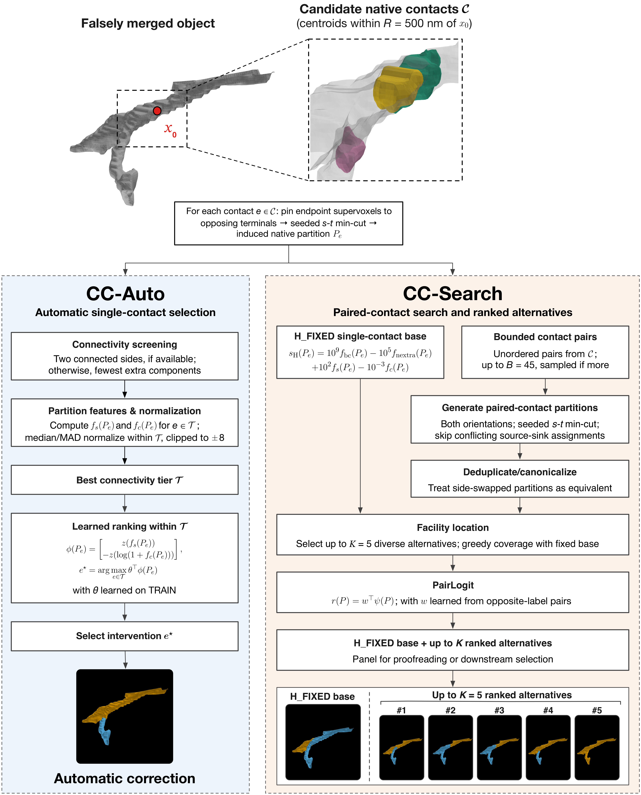
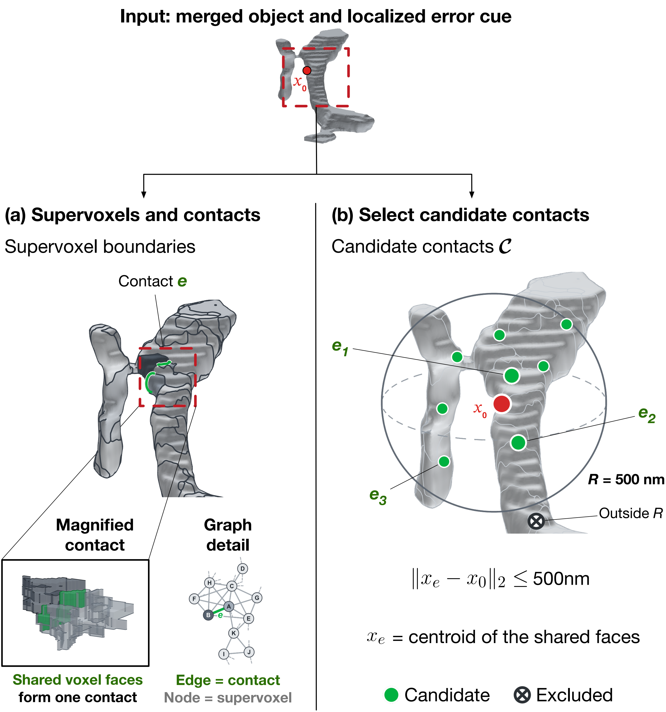
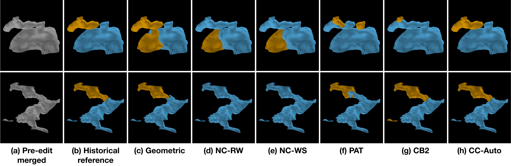

# ContactCut: 

**A Partition-Aware Contact Selection Framework for False-Merge Correction in Connectomics**

[Byunghyun Ko](https://bentake.github.io/)¹, [Won-Ki Jeong](https://hvcl.korea.ac.kr/?page_id=359)², [Chaoli Wang](https://sites.nd.edu/chaoli-wang/)¹

¹ Department of Computer Science and Engineering, University of Notre Dame, Notre Dame, IN, USA
² Department of Computer Science and Engineering, Korea University, Seoul, Korea



Overview of ContactCut. CC-Auto performs learned single-contact selection, while CC-Search expands the
candidate space with bounded contact pairs and returns an H_FIXED base with up to five ranked
alternatives.

## Introduction

Localized false-merge correction requires turning an identified error into an executable native 3D
partition, but neither intermediate correction predictions nor seeded graph solvers alone determine
which native source–sink constraints should define that partition. ContactCut formulates this as a
**3D-native partition-aware contact selection** problem: given a falsely merged object and a localized
interface cue `x0`, it enumerates nearby native **contacts**, assigns each contact's endpoint supervoxels to
opposing terminals, and evaluates the complete partition induced by a fixed seeded *s–t* min-cut. It
selects among these partitions in two modes:

- **CC-Auto** — a learned two-feature, two-parameter ranker for automatic single-contact selection.
- **CC-Search** — bounded paired-contact search + a greedy facility-location panel (`K = 5`) + a learned
  PairLogit ranker, producing a compact panel for proofreading or downstream selection.

ContactCut is CPU-only and ground-truth-free at inference; the historical reference (the two post-edit
descendants) is used only to *label* training preferences and to *score* final partitions. Both
learned rankers transfer from MICrONS to FlyWire without retraining.

## Method



Supervoxel contacts and candidate selection. (a) Supervoxels correspond to graph nodes.
The voxel faces shared by two supervoxels form a contact, represented by a graph edge. (b) Candidate
contacts have centroids within 500 nm of the localized error cue `x0` (red). Shown candidate centroids
are green; the crossed marker denotes an excluded contact.

See `Figures/methodology.png`. In brief: build the native contact graph (node mass = native voxel
count, edge capacity = shared-face count). A contact centroid is the arithmetic mean of its shared-face
centers in physical coordinates. Enumerate contacts whose centroids lie within `R = 500 nm` of `x0`,
and induce a partition per contact with a seeded *s–t* min-cut (terminal capacity
`C∞ = 8(2·Σ c_e + 1)`). **CC-Auto** ranks within the best connectivity tier by
`theta · [z(f_s), −z(log(1 + f_c))]`. Here `f_s` is the smaller-side native-voxel fraction, and `f_c` is
the cut contact size: the sum of shared-face counts over all edges crossing the partition.
**H_FIXED** is the deterministic, non-learned base for **CC-Search**, which samples up to `B = 45`
contact pairs and selects `K = 5` diverse alternatives by facility location. PairLogit, a pairwise
logistic ranker, orders the alternatives; the H_FIXED base remains available. Full formulas and
constants live in `contactcut/{pipeline,search,pairlogit}.py`.

## Experiments

ContactCut is evaluated on genuine historical two-way false-merge corrections from **MICrONS** minnie65
and **FlyWire** FAFB. CC-Auto achieves the highest failure-aware 3D partition (FA-3D Part.) mIoU —
**0.657** on MICrONS and **0.641** on FlyWire — improving on the strongest graph-based control by
**5.9** and **3.4** points, and on the best evaluated learned baseline by **12.5** and **10.0** points. A
MICrONS-trained CC-Auto ranker transfers to FlyWire with negligible loss (0.641 → 0.640). Bounded
paired-contact search expands oracle reachability, and the learned panel ranker prioritizes near-oracle
alternatives. The figure below shows qualitative results against the historical reference and baselines
(Geometric, nearest-contact × random-walker / watershed, PAT, CB2).



Qualitative 3D-native correction results. Predictions are shown against the historical reference.

The commands in the next section reproduce the paper tables from per-operation `.npz` inputs.

## Installation, Train, and Test

```bash
conda create --name contactcut python=3.11
conda activate contactcut
pip install -r requirements.txt

# Automatic correction (CC-Auto) — MICrONS / FlyWire TEST
python scripts/run_auto.py --op-dir <OPS> --manifest <MANIFEST.csv> \
       --dataset microns --model models/cc_auto_microns.json --out out/microns
python scripts/run_auto.py --op-dir <OPS> --manifest <MANIFEST.csv> \
       --dataset flywire --model models/cc_auto_flywire.json --out out/flywire
# zero-shot transfer (MICrONS theta applied to FlyWire)
python scripts/run_auto.py --op-dir <OPS> --manifest <MANIFEST.csv> \
       --dataset flywire --model models/cc_auto_microns.json --transfer --out out/flywire_transfer

# Bounded search + PairLogit panel (CC-Search) — NEAR05@k
python scripts/run_search.py --op-dir <OPS> --manifest <MANIFEST.csv> \
       --dataset microns --pairlogit models/pairlogit_microns.json --out out/search

# (optional) retrain the learned components; reproduces the frozen models
python scripts/train_auto.py      --op-dir <TRAIN_OPS> --manifest <TRAIN.csv> --dataset microns --out out/cc_auto.json
python scripts/train_pairlogit.py --op-dir <TRAIN_OPS> --manifest <TRAIN.csv> --dataset microns --out out/pairlogit.json
```

`train_auto` reproduces the frozen `theta` (MICrONS `(0.22145, 0.04522)`, FlyWire `(0.24119, 0.09230)`)
on the corresponding TRAIN split.

## Data

ContactCut consumes **one `.npz` per operation** plus a manifest CSV of `operation_id,dataset` rows.
Schema (`contactcut/data.py`):

| key | shape / type | meaning |
|-----|--------------|---------|
| `seg` | `(Z,Y,X)` int | native supervoxel id volume (local crop) |
| `merged` | `(Z,Y,X)` bool | pre-edit merged-object mask |
| `lo` | `(3,)` int | crop origin `(z,y,x)` in native voxels |
| `sv` | `(Z,Y,X)` int | CAVE supervoxel id per voxel (GT lookup) |
| `gtl` / `nid` / `N` | int | GT side (0/1) per GT node id, and their count |
| `interface_xyz_nm` | `(3,)` float | interface cue `x0`, nm, CAVE `(x,y,z)` order |
| `dataset` | str | `"microns"` or `"flywire"` |

These are materialized from the public MICrONS / FlyWire version history via CAVE / ChunkedGraph. Data
access, licensing, and materialization are governed by those projects; **this repository does not
redistribute their data.** Once the `.npz` files exist for a split, the commands above reproduce the
paper numbers with no further inputs.

## Dependencies

Python 3.10–3.12; `numpy`, `scipy`, `networkx`, `pandas`, `scikit-learn` 

## Contact

Byunghyun Ko — bko2@nd.edu

## Acknowledgements

This research was supported in part by the U.S. National Science Foundation through grant OAC-2104158
and the U.S. National Institutes of Health through grant 7R01HL177814.

## Citation

TBA
